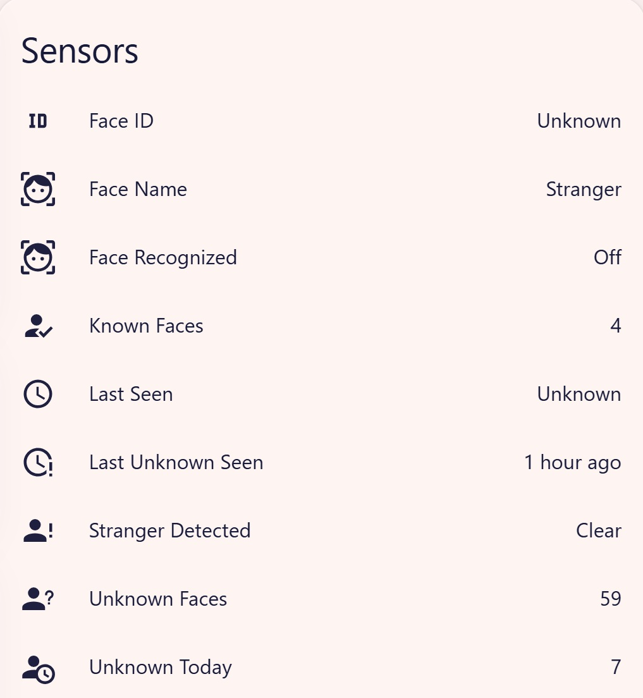
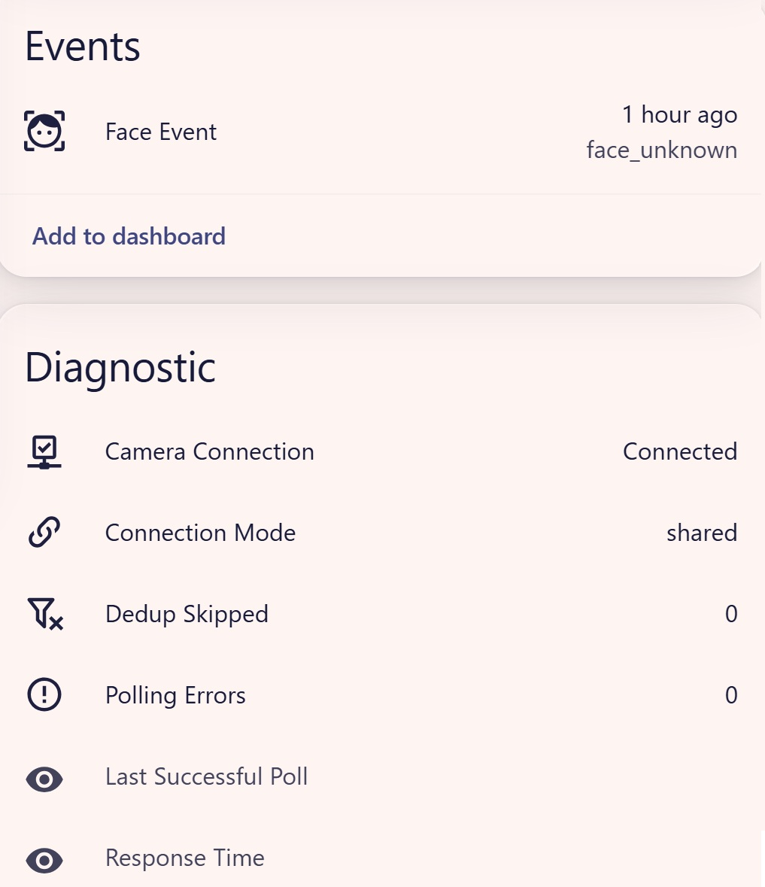
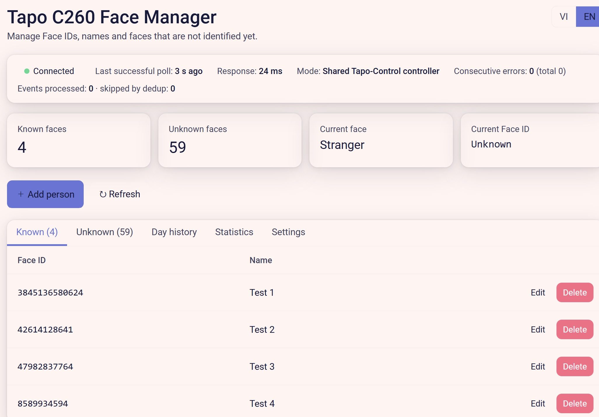
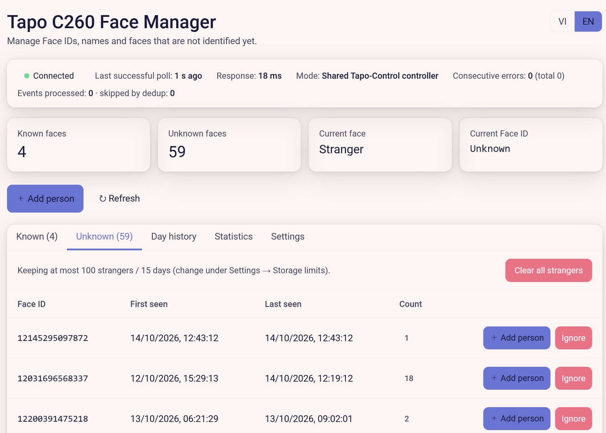
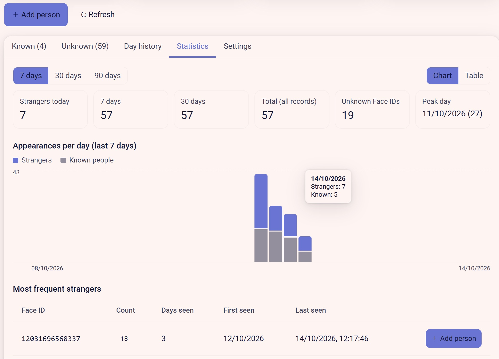
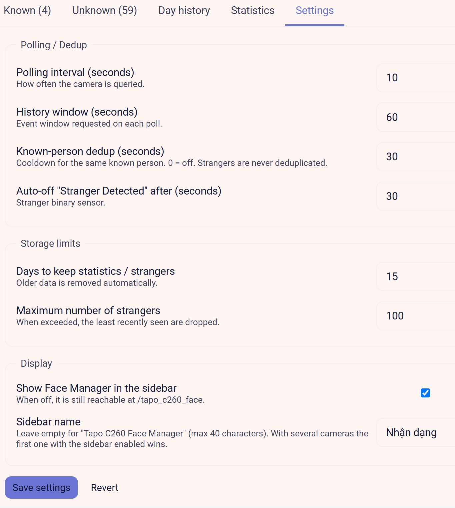
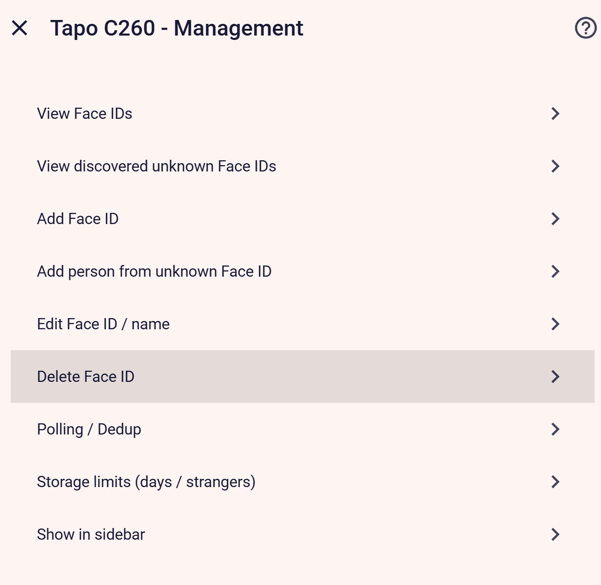

# Tapo C260 Face Recognition for Home Assistant

🇬🇧 English · [🇻🇳 Tiếng Việt](README.vi.md)

A Home Assistant custom integration that reads the **face-recognition events of a TP-Link Tapo C260** camera over the local network and turns them into entities, events and a management panel ("Face Manager"): who was seen, when, how often, and who is a stranger.

> **Unofficial.** Not affiliated with or endorsed by TP-Link. It uses the camera's local API with your *camera account* (Cloud Password). Use at your own risk.

## Features

- Poll the camera for face events; map camera **Face IDs → names** (the camera itself only knows IDs).
- Strangers are tracked automatically, so you can promote an unknown ID to a named person later.
- **Several faces in one event** are each handled separately (e.g. a known person together with a stranger).
- Per-event de-duplication, with a cooldown for known people.
- **Face Manager** sidebar panel (Vietnamese / English switch):
  - known / unknown people, add / rename / delete;
  - **day history** – who appeared at what time, first and latest sighting of the day;
  - **statistics** – strangers today / 7 / 30 days, chart, top strangers, per-person counts;
  - **integration health** – last successful poll, response time, errors, connection mode, dedup counter;
  - **settings** – polling, dedup, retention limits, sidebar visibility and name.
- Renaming a person applies to **all earlier records** (history stores Face IDs; names are resolved at display time).
- Retention limits: keep statistics/strangers for N days and at most M strangers.
- Works **together with Tapo-Control** by reusing its controller for the same camera, so the two integrations do not fight over the camera session (see [Operation modes](#operation-modes)).
- Re-authentication flow when the camera rejects the login.

## Requirements

- Home Assistant **2026.9.4** or newer (minimum declared version).
- A Tapo **C260** with face recognition enabled in the Tapo app, and a camera account (username + Cloud Password).
- Optional: the [Tapo-Control](https://github.com/JurajNyiri/HomeAssistant-Tapo-Control) integration for the same camera.

## Tested environment

- Camera: Tapo C260 with firmware `1.2.3 Build 260805 Rel.20715n` and `1.3.2 Build 260902 Rel.25093n`.
- Tapo-Control (Tapo: Cameras Control): the latest version available at the time of testing.

## Installation

### HACS (custom repository)

1. HACS → ⋮ → **Custom repositories** → add `https://github.com/quangtienhn/tapo-c260-face`, category **Integration**.
2. Download **Tapo C260 Face Recognition**, then restart Home Assistant.
3. Settings → Devices & services → **Add integration** → *Tapo C260 Face Recognition*.

### Manual

Copy `custom_components/tapo_c260_face` into your Home Assistant `config/custom_components/` folder and restart.

## Setup

1. Settings → Devices & services → **Add integration** → *Tapo C260 Face Recognition*.
2. Fill in the setup form (the same form is used in both operation modes — see [Operation modes](#operation-modes)):

   | Field | What to enter |
   |---|---|
   | **Host** | LAN IP address of the Tapo C260, e.g. `192.168.1.188`. |
   | **Username** | The camera account name configured on the camera for local / third-party connections. This is not your Tapo Cloud account email. |
   | **Cloud Password** | The camera's Cloud Password for that account. The integration uses it only inside the camera's local challenge/response login (`cnonce`/`nonce`, `digest_passwd`; the password is hashed into a digest, never sent as plain text). It is stored in the Home Assistant config entry, like any other integration's credentials. |

3. The login is verified against the camera immediately. If the camera later rejects it, a re-authentication flow asks for the username and Cloud Password again.
4. The integration's code requires no other preparation step (no compatibility toggle inside this integration): it connects straight to the camera's local API at the given IP with the camera-account credentials above.
5. Never type credentials into README files, GitHub issues, URLs, or public logs and screenshots.

Then open **Face Manager** (sidebar, or `/tapo_c260_face`), look at the *Unknown* tab after the camera has seen someone, and press **Add person** to give that Face ID a name.

## Screenshots


*Device sensors: latest face, known/unknown counts, stranger detection state and health counters.*


*Device page: a `face_unknown` event plus diagnostic sensors. Here Connection Mode is `shared`, i.e. shared-controller mode (see below).*


*Face Manager, Known tab: Face ID → name mappings, health banner and connection mode.*


*Face Manager, Unknown tab: discovered Face IDs with first/last sighting and counts; promote one with Add person.*


*Face Manager, Statistics tab: stranger counts, appearances-per-day chart and most frequent strangers.*


*Face Manager, Settings tab: polling/dedup, storage limits and sidebar display options.*


*Integration options menu (Configure → Management): manage Face IDs, polling, retention and sidebar.*

## Entities (per camera)

| Entity | Description |
|---|---|
| `sensor.…_face_name`, `…_face_id` | Latest face (known people preferred inside one event). |
| `sensor.…_last_seen` | Camera time of the latest event. |
| `sensor.…_known_faces`, `…_unknown_faces` | Number of configured / discovered IDs. |
| `sensor.…_unknown_today`, `…_last_unknown_seen` | Strangers today / last stranger. |
| `binary_sensor.…_face_recognized` | Latest face is a known person. |
| `binary_sensor.…_stranger_detected` | On when a **new** stranger event arrives; auto-off after N seconds (default 30). |
| `event.…_face_event` | `face_recognized` / `face_unknown` with `face_id`, `name`, `event_time`, … |
| `binary_sensor.…_camera_connection`, `sensor.…_polling_errors`, `…_connection_mode`, `…_dedup_skipped` | Health (always available, even when polling fails). |
| `…_last_successful_poll`, `…_response_time` | Health, disabled by default (they change on every poll). |

The bus event `tapo_c260_face_detected` is fired for every new face with `face_id`, `name`, `recognized`, `event_time`, `camera`, `event_face_ids`, …

> Note: for a stranger the `Face Name` sensor reports `Stranger` (legacy versions ≤ 0.1.7.0 reported `Người lạ`; update any automations comparing the state).

## Example automations

```yaml
automation:
  - alias: Stranger at the door
    triggers:
      - trigger: state
        entity_id: binary_sensor.CAMERA_stranger_detected
        to: "on"
    actions:
      - action: notify.notify
        data:
          message: "Unknown face detected"

  - alias: Known person arrived
    triggers:
      - trigger: event
        event_type: tapo_c260_face_detected
        event_data:
          recognized: true
    actions:
      - action: notify.notify
        data:
          message: "{{ trigger.event.data.name }} was seen"
```

## Operation modes

The setup form is identical in both modes: the login is always verified against the camera when the entry is created. What differs is how each poll queries the camera afterwards.

|  | Standalone mode | Shared-controller mode |
|---|---|---|
| Needs Tapo-Control installed | No | Yes, with an entry for the same camera IP |
| Camera queries go through | The integration's own session | Tapo-Control's existing controller (`searchDetectionList`) |
| Separate camera login session | Yes | No — it borrows the already-authenticated controller and never starts its own login while in this mode |
| Credentials required at setup | Yes | Yes (validated once at setup) |
| Tapo-Control entry exists but is still starting | n/a | Waits without logging in on its own; health reports `waiting` until the controller is ready |
| Tapo-Control entry disabled / failing / has no usable controller | n/a | Falls back to its own session |
| Modifies your Tapo-Control configuration | No | No |

### Standalone mode

No Tapo-Control needed. The integration performs the camera's local secure login itself (challenge/response with `cnonce`/`nonce`, `digest_passwd`, `lsk`/`ivb` session keys, via its own asyncio implementation) and polls `searchDetectionList` over its own encrypted session. It never touches a Tapo-Control session or controller in this mode, because there is none to share.

### Shared-controller mode

When a Tapo-Control config entry for the same camera IP exists and its controller is ready, this integration calls `searchDetectionList` **through that controller** instead of logging in on its own, so the two integrations do not fight over the camera session. While the Tapo-Control entry is still setting up it waits (returning a harmless empty state so setup can finish and retry on the next poll) instead of opening a second session. If the Tapo-Control entry is disabled, fails, or is loaded but exposes no usable controller, the integration logs a warning and uses its own session. This mode only *reads* the controller object at runtime; it does not replace, reconfigure, or otherwise modify your Tapo-Control setup. It relies on Tapo-Control's internal data structures, so it may break when Tapo-Control changes them (tested with the latest Tapo-Control version available at the time of testing).

## Data and privacy

Everything stays local. Camera credentials are stored in the Home Assistant config entry (like any integration). Face-ID → name mappings are stored in the config entry options; stranger lists and history are stored in `.storage/tapo_c260_face.*`. No faces or images are stored – only the numeric IDs the camera reports.

## Known limitations

- Tested on one camera model (C260) with firmware `1.2.3 Build 260805 Rel.20715n` and `1.3.2 Build 260902 Rel.25093n`.
- Statistics and time history start from the version that introduced them.
- Entity names are English; the Face Manager panel and the config flow are available in English and Vietnamese.

## Acknowledgements

The camera's local secure login (challenge/response with `cnonce`/`nonce`, `digest_passwd`, `lsk`/`ivb` session keys) follows the protocol documented by the open-source [pytapo](https://github.com/JurajNyiri/pytapo) project (MIT, © Juraj Nyíri). This repository contains its own asyncio/aiohttp implementation and bundles no source files from pytapo or Tapo-Control. The optional shared mode talks to the controller object of [Tapo-Control](https://github.com/JurajNyiri/HomeAssistant-Tapo-Control) (Apache-2.0) at runtime. Thanks to those projects.

## License

[MIT](LICENSE)
